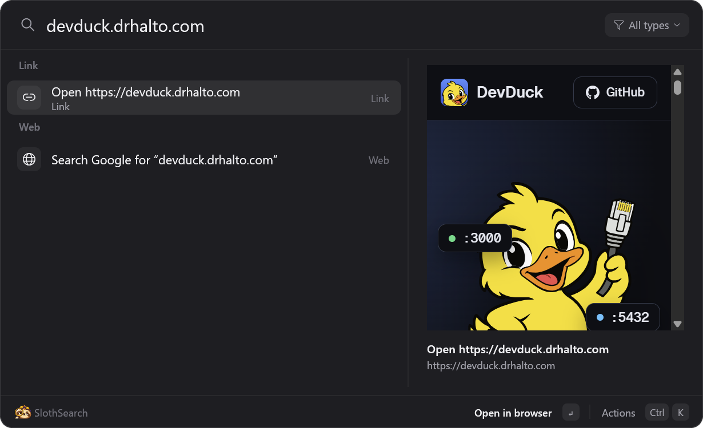

<p align="center"></p>

# SlothSearch

Spotlight for Windows, in Rust. Press **Alt+Space** and type: apps, files, open windows, git
repos, Settings pages, math and unit conversions, and web addresses all come back in one ranked
list, as you type. Files come from [Everything](https://www.voidtools.com/), so the whole disk is
searched in about 50 ms. The mascot is a sloth. It is not a sloth.



## Install

Needs Windows 11 (or 10 with WebView2) and Everything 1.4 running.

```powershell
.\scripts\install.ps1            # build, install to %LOCALAPPDATA%\Programs\SlothSearch, start at login
.\scripts\install.ps1 -Uninstall # remove (settings in %APPDATA%\SlothSearch stay)
```

## Using it

| Keys | Does |
| --- | --- |
| Alt+Space | Open / close |
| Alt+` | Open straight into the window switcher (Alt+Tab you can type into) |
| Up/Down, Tab | Move |
| Enter | Open, switch to, run, or copy (calculator) |
| Ctrl+Enter | Show in Explorer |
| Ctrl+K | All actions for the selected row |
| Ctrl+E / Ctrl+T / Ctrl+L | Open in VS Code / Terminal / start Claude Code there |
| Ctrl+Shift+C / Ctrl+Shift+F | Copy path / copy the file itself |
| Ctrl+Shift+Enter | Run as administrator |
| Alt+Enter | Properties |
| Ctrl+D | Add to / remove from Favorites |
| Ctrl+Tab / Ctrl+Shift+Tab | Next / previous type filter |
| Ctrl+Shift+Up/Down, F2 | Move / rename a favorite (on the empty-box screen) |
| Ctrl+1…9 | Open the nth result |
| Backspace (empty box) | Drop the type filter, then the Explorer folder |
| Esc | Clear, then close |

- **Favorites:** the empty search box shows your pinned results (apps, web pages, Settings
  pages, folders, repos: anything you press Ctrl+D on), then your last five picks.
- **Type filters:** `type:pdf`, `type:image`, `type:video`, `type:doc`, `type:sheet`,
  `type:slides`, `type:code`, `type:md`, `type:html`, `type:archive`, `type:3d`, `type:font`,
  `type:exe`, `type:file`, `type:folder`, `type:app`, `type:window`, `type:project`,
  `type:command`, or any extension (`type:stl`, `type:blend`). Typing a space turns it into a
  chip; the button at the right of the search bar picks one; Ctrl+Tab cycles. With no other
  text, a file filter lists the newest of that type (`type:pdf` = recent PDFs). Works inside an
  Explorer folder too.
- **From Explorer:** open it while an Explorer window is in front and it searches that folder
  (the active tab), and Enter on a folder navigates that same window. Backspace on an empty box
  searches everywhere instead.
- **Windows:** Alt+` (or `type:window`) lists open windows in Alt+Tab order.
- **Preview pane:** text files show their first lines, images and videos show Explorer's
  thumbnail, and HTML, Markdown, SVG and PDF render live in WebView2 (scripts off). Typed URLs,
  `localhost:3000` included, render the live page after a short pause. Repos show their README.
- **Learns:** whatever you pick for a search ranks first for that search next time.
- **Everything syntax works:** `ext:pdf invoice`, `*.rs`, `dm:today`, paths.
- Built-in commands: lock, sleep, restart (asks twice), Settings pages, admin tools, folders,
  toggle dark mode, empty the Recycle Bin, restart Everything.

## Settings

`%APPDATA%\SlothSearch\config.toml` (search "SlothSearch settings" or press Ctrl+, in the
launcher). Hotkeys, Explorer scoping, the web search engine, theme, domain endings for names on
your own network (`link_domains`, so `nas.home` opens as a link), and the folders kept out of
file results (node_modules, build caches, AppData...). Changes apply the next time it opens.

## How it works

- `everything.rs` speaks Everything's IPC directly (WM_COPYDATA, the protocol the SDK DLL uses),
  so there's no DLL to ship. All queries go through one worker thread: Everything slows to a
  crawl when two clients query at once. Exclusions are filtered in Rust after the query,
  because path filters inside an Everything query cost ~150 ms each.
- `search.rs` ranks: exact > prefix > word start > initials > substring > tight fuzzy match,
  weighted by kind (apps first), recency, location, and history.
- `apps.rs` reads `shell:AppsFolder` (the Start menu's list, Store apps included); `wins.rs`
  filters windows the way Alt+Tab does; `explorer.rs` finds the active Explorer tab's folder
  through `IShellWindows`.
- The UI is egui (eframe/glow) in a transparent always-on-top window; `shell.rs` owns the
  hotkeys and tray icon on its own thread.
- A CLI for testing ranking: `slothsearch query devduck`,
  `slothsearch typing devduck` (replays keystrokes through the worker), `slothsearch wins`.

## Brand

The sloth was generated with gpt-image-2 (via Codex) on flat magenta, then keyed and packed by
`python scripts/make-brand.py` into the app icon and the two images the UI embeds.
